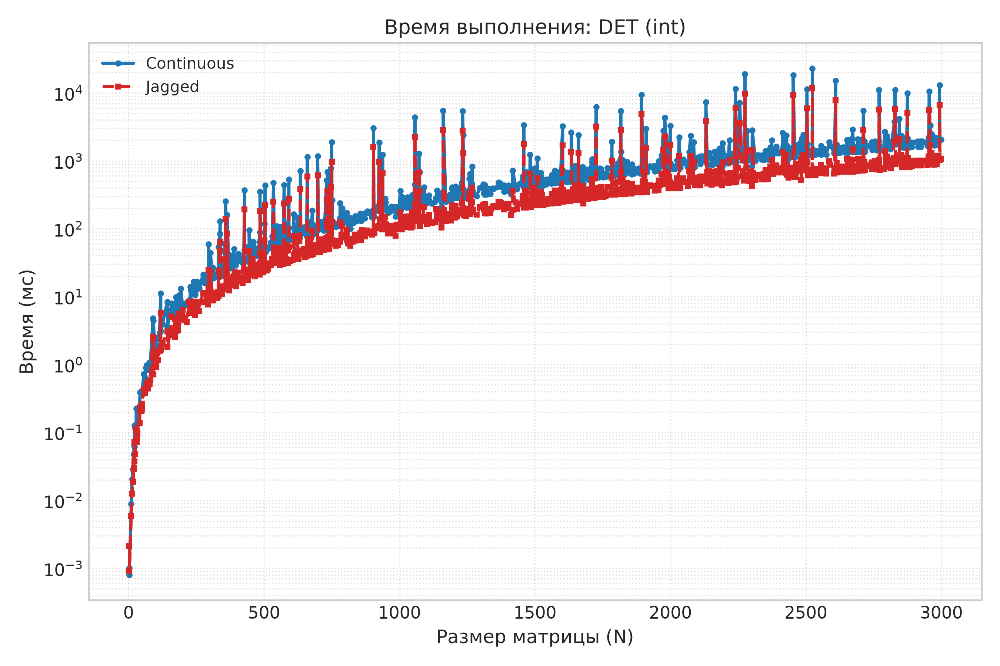
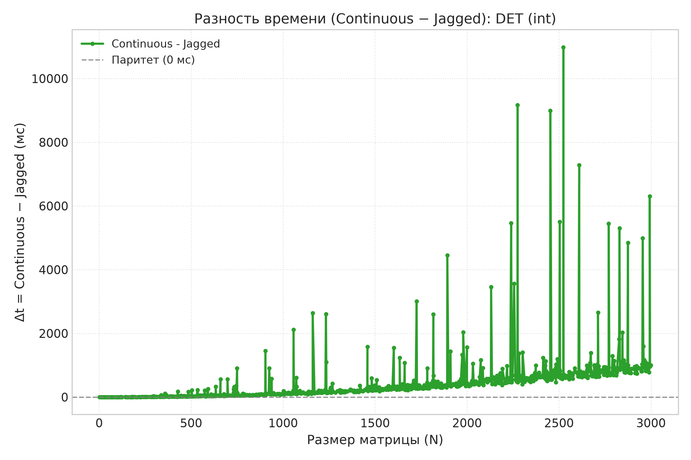
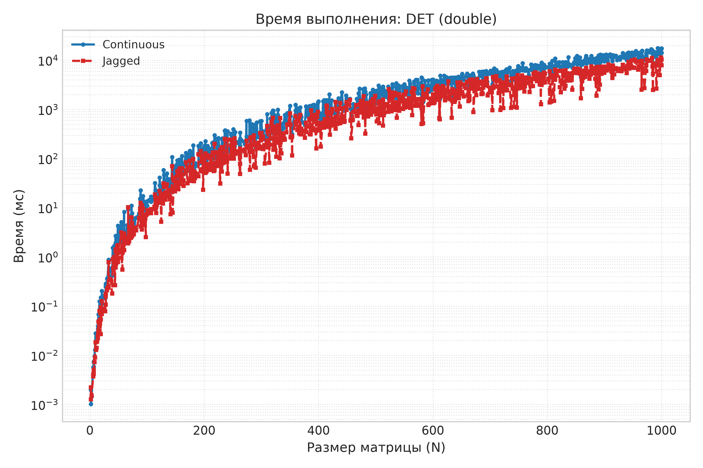
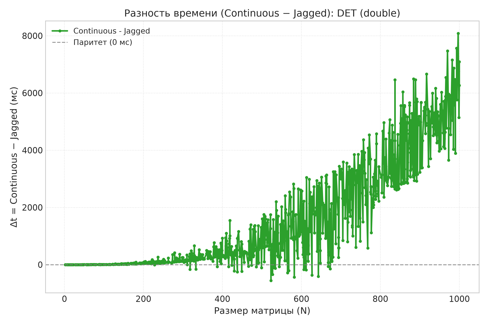
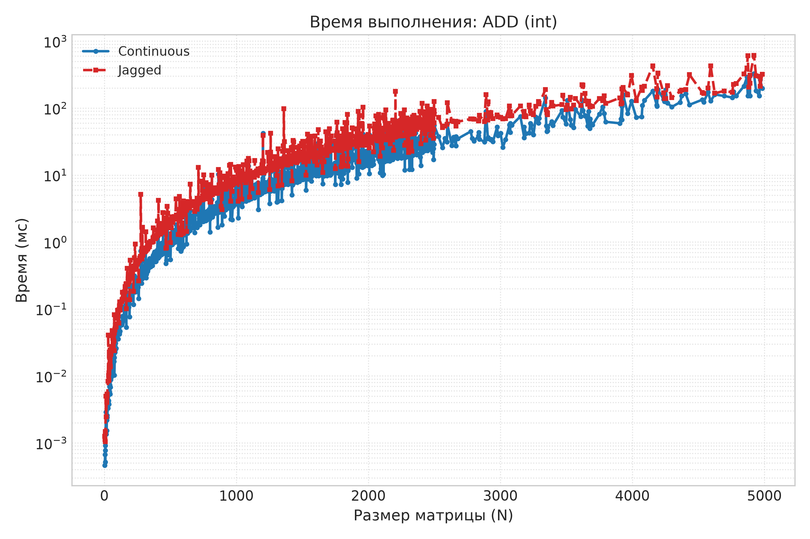
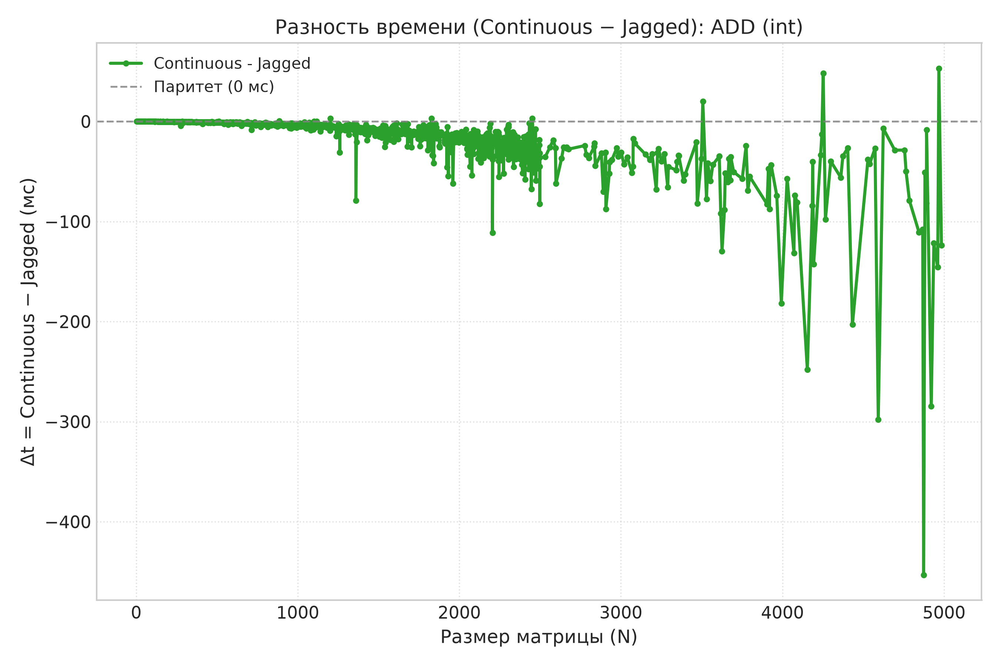
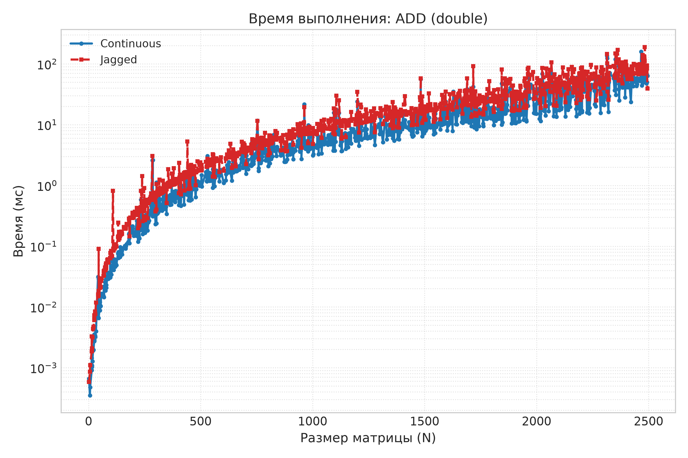
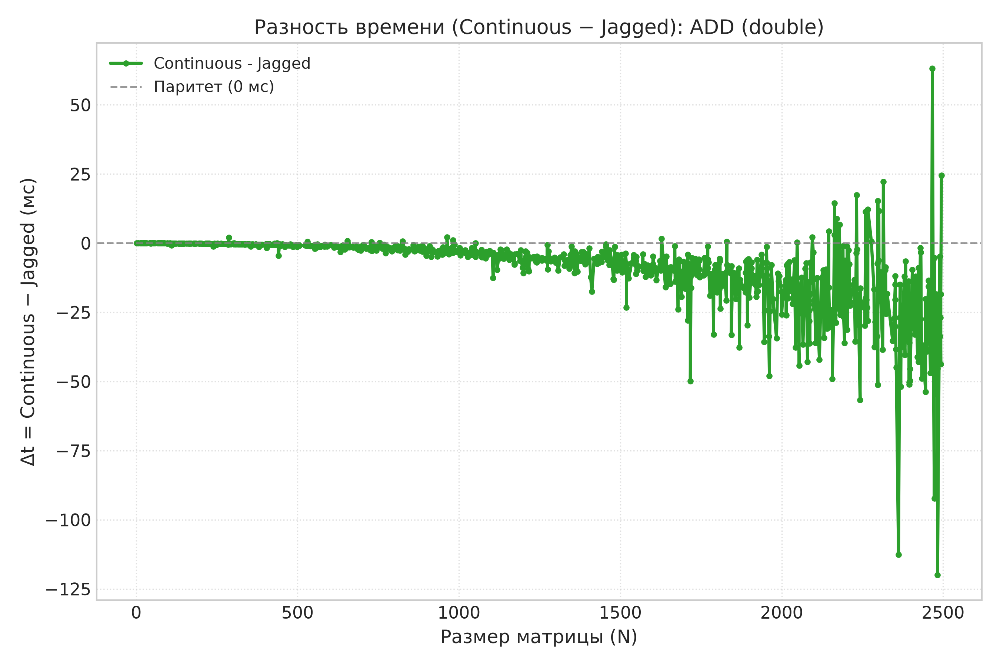

# Отчет по сравнению реализаций квадратной матрицы (`ContinuousMatrix` и `JaggedMatrix`)

Задачей работы было сравнить две реализации квадратной матрицы — на непрерывном буфере и на массиве указателей.

## Описание реализаций и структура проекта

В проекте реализованы два основных класса матриц (исходный код находится в директории `matrix_src/`):
- **`JaggedMatrix`** — класс, реализующий матрицу через массив указателей (каждая строка выделяется отдельно в динамической памяти).
- **`ContinuousMatrix`** — класс, реализующий матрицу на едином непрерывном буфере памяти.

Общая логика вычисления определителя вынесена в отдельный класс-миксин `CommonDeterminantCountMixin`. Корректность работы обеих матриц проверяется модульными тестами в папке `tests/` (`TestContinuous.cpp` и `TestJagged.cpp`).

Сравнение производилось по скорости работы трех основных операций (код замеров расположен в `experiment/`):
1. Нахождение детерминанта (`experiment_determinant.cpp`).
2. Сложение матриц (`experiment_addition.cpp`).
3. Перемножение матриц (`experiment_multiplication.cpp`).

Для нахождения детерминанта в зависимости от типа элементов использовались разные подходы:
- Для целочисленных матриц использовался **алгоритм Барейса**, позволяющий проводить вычисления без остатка и потери точности.
- Для матриц с числами с плавающей точкой использовался **алгоритм Гаусса** для приведения матрицы к верхнетреугольному виду, а затем перемножались диагональные элементы.

## Методика сравнения

Сравнение происходило следующим образом: с помощью генератора тестов `test_generator` (`TestGenerator.hpp`) генерировалось порядка тысячи случайных матриц разных размеров, после чего для обоих типов матриц проводились соответствующие операции и считалось время их выполнения. Итоговые данные замеров сохранены в `experiment_data_final/`, а построенные по ним графики лежат в папке `graphs/`.

Для каждого эксперимента ниже приведены графики для целочисленного типа (`int`) и для типа с плавающей точкой (`double`). Для каждого типа представлено по два графика: первый — обычное время выполнения для обеих матриц, второй — разность времени выполнения между реализациями.

---

## Результаты сравнения

### 1. Нахождение детерминанта

#### Графики для `int`:

#### Графики для `double`:

Как видно по графикам (`int_det_*` и `double_det_*` из папки `graphs/`), в обоих случаях матрица на массиве указателей (`JaggedMatrix`) рассчитывает детерминант быстрее. Это происходит, скорее всего, за счет того, что при приведении матрицы в алгоритмах Гаусса и Барейса требуется переставлять строки местами: операция перестановки строк для массива указателей выполняется за $O(1)$ (достаточно просто поменять местами два указателя), а для непрерывного буфера — за $O(N)$ (приходится поэлементно обменивать все значения в строках).

---

### 2. Сложение матриц

#### Графики для `int`:

#### Графики для `double`:

При сложении матриц (`int_add_*` и `double_add_*` в `graphs/`), скорее всего за счет лучшей локальности памяти, непрерывный буфер (`ContinuousMatrix`) превосходит массив указателей (`JaggedMatrix`), кроме небольшого количества отдельных выбросов, которые, возможно, можно списать на какие-то эффекты в памяти или фоновую активность системы в момент замеров.

---

### 3. Перемножение матриц

#### Графики для `int`:

#### Графики для `double`:

На небольших (порядка 300) размерах матриц непрерывный буфер и массив указателей дают почти одинаковый результат. На больших же размерах наблюдается ощутимое различие во времени на всех измерениях. Причем в случае, когда `ContinuousMatrix` оптимальнее, она дает больший выигрыш. Я думаю что это связано с тем, что когда нам "везет" и система оптимально работает с непрерывным буффером - не случается переполнения каких-то локальных кешей и так далее `ContinuousMatrix` оптимальнее. В остальных случая выигрывает `JaggedMatrix`
