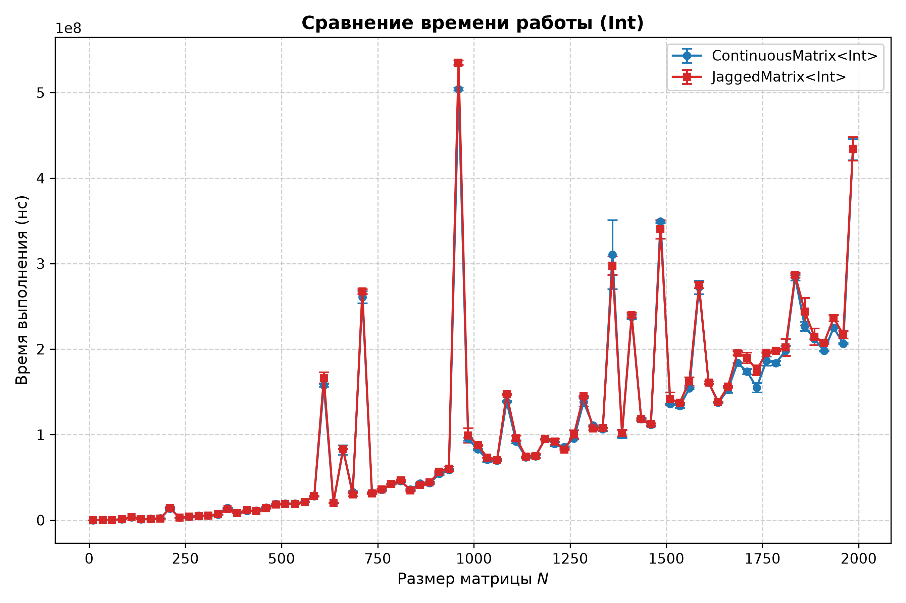
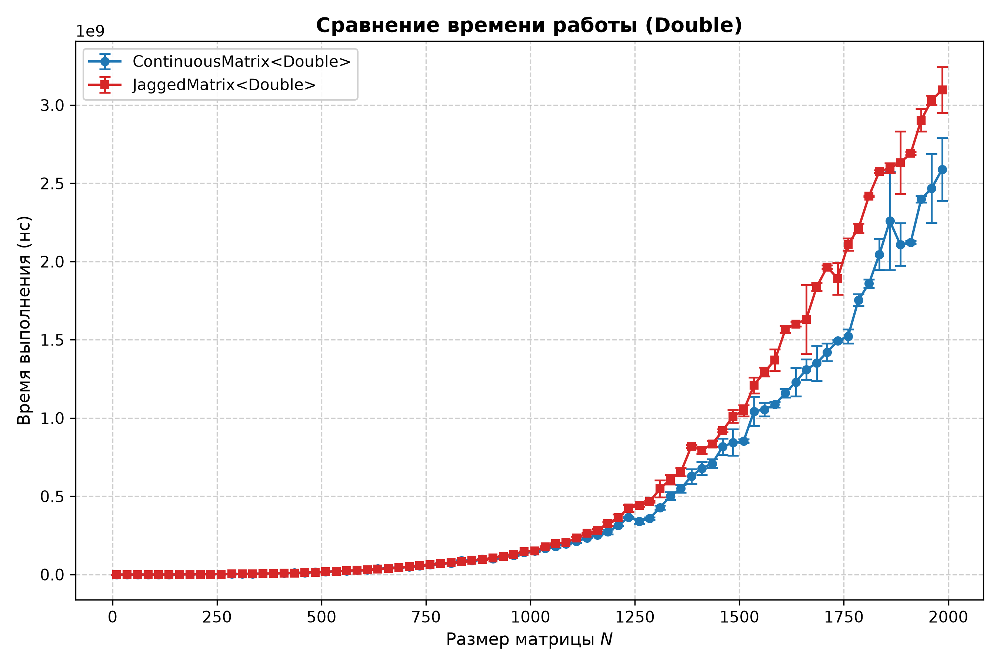
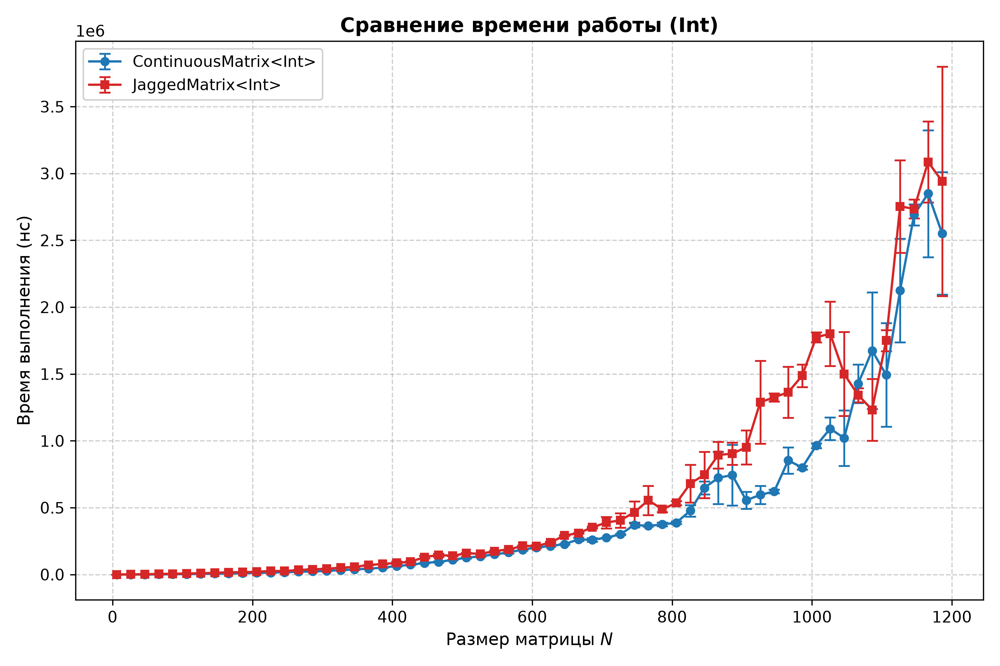
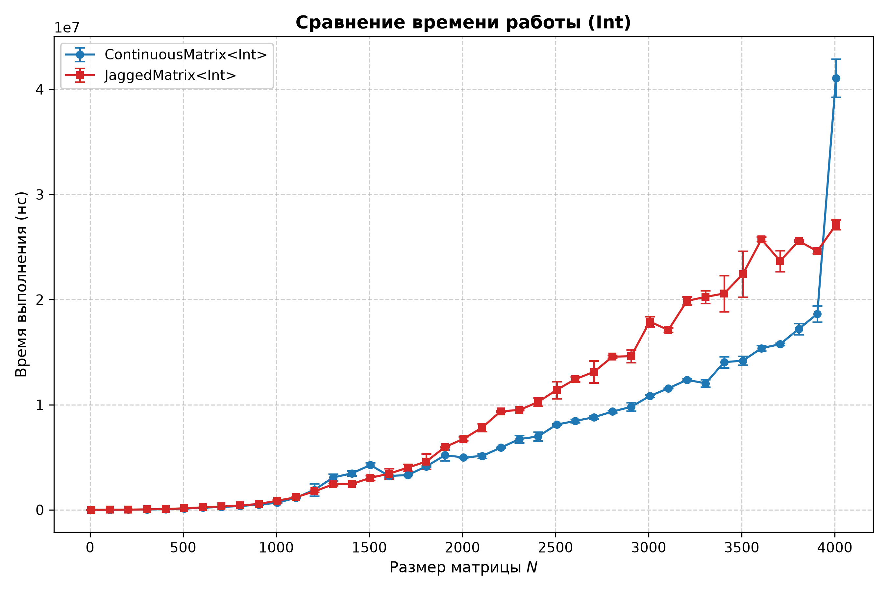
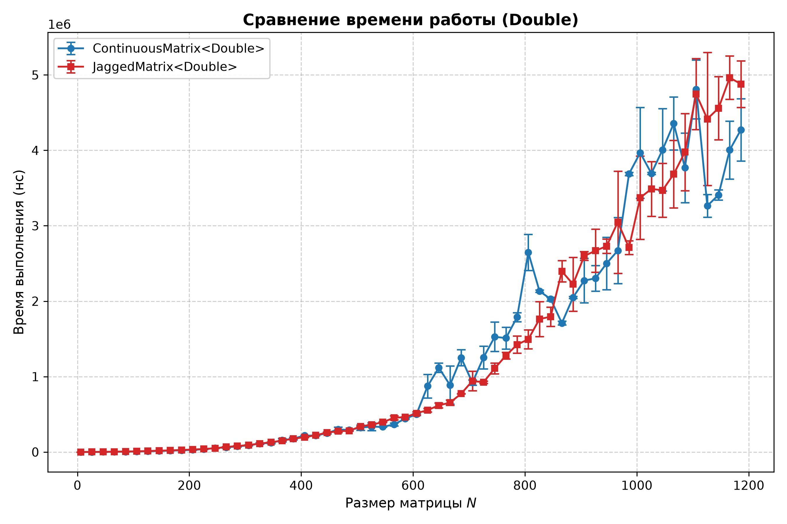
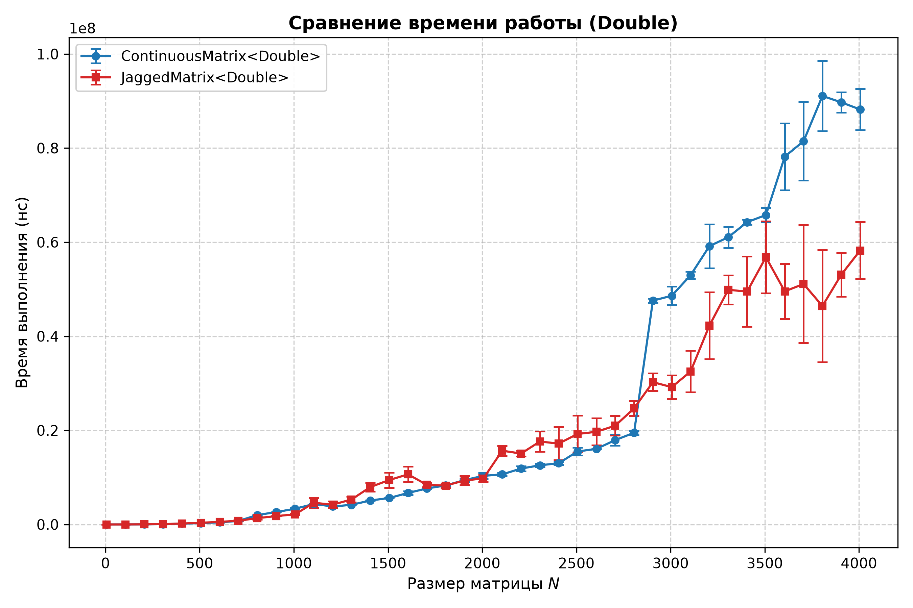
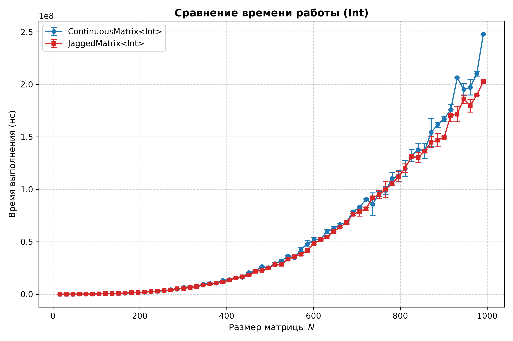
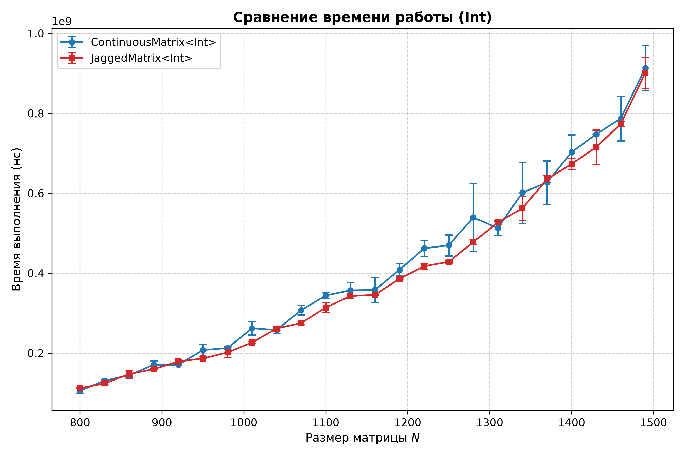
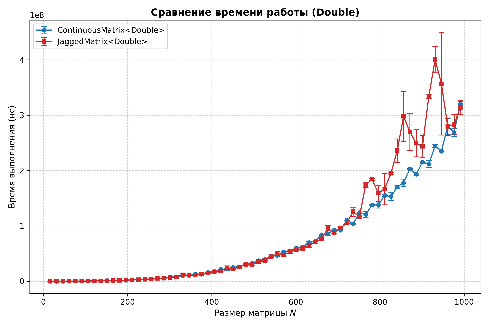
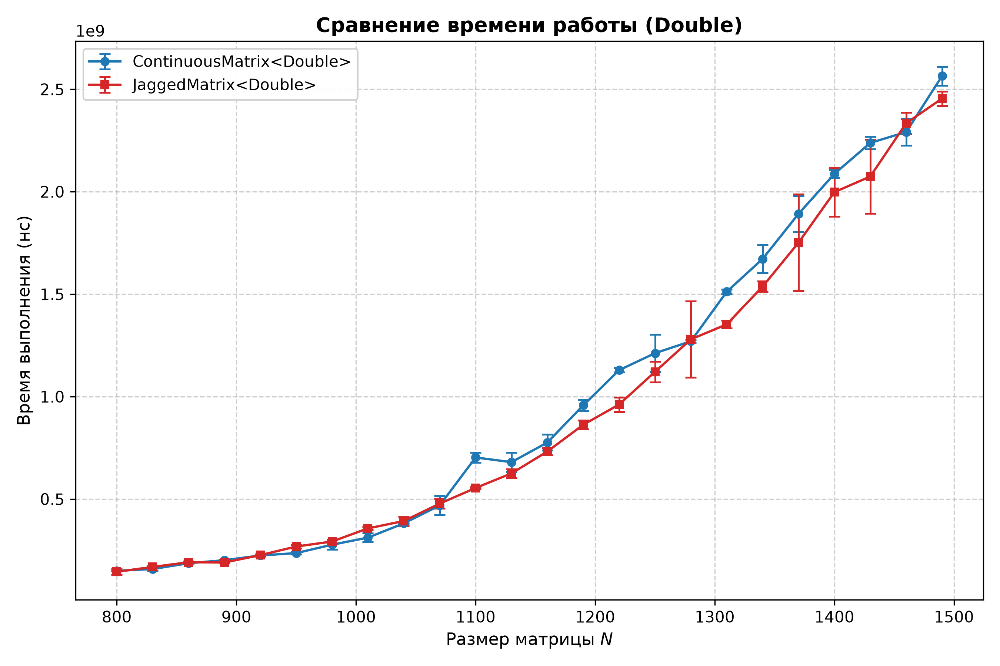

# Отчет по сравнению реализаций квадратной матрицы (`ContinuousMatrix` и `JaggedMatrix`)

Задачей работы было сравнить две реализации квадратной матрицы — на непрерывном буфере и на массиве указателей.

## Описание реализаций и структура проекта

В проекте реализованы два основных класса матриц (исходный код находится в директории `matrix_src/`):
- **`JaggedMatrix`** — класс, реализующий матрицу через массив указателей (`ValType**`), где каждая строка выделяется отдельно в динамической памяти.
- **`ContinuousMatrix`** — класс, реализующий матрицу на едином непрерывном буфере памяти (`ValType*`) с вычислением смещения `row * size_ + col`.

Общая логика вычисления определителя и обращения матрицы вынесена в отдельный класс-миксин `CommonDeterminantCountMixin` (`DeterminantMixin`). Корректность работы обеих реализаций, соблюдение семантики перемещения (Rule of 5) и краевые случаи проверяются модульными и сквозными (e2e) тестами на базе GoogleTest в папке `tests/` (`TestContinuous.cpp` и `TestJagged.cpp`).

Сравнение производилось по скорости работы трех основных операций (код бенчмарков расположен в `benchmark/`):
1. Нахождение детерминанта (`benchmark_determinant.cpp`).
2. Сложение матриц (`benchmark_addition.cpp`).
3. Перемножение матриц (`benchmark_multiplication.cpp`).

Для нахождения детерминанта в зависимости от типа элементов использовались разные подходы:
- Для целочисленных матриц (`int`) использовался **алгоритм Барейса**, позволяющий проводить вычисления без остатка и потери точности (с расширением промежуточного типа при умножении для предотвращения знакового переполнения).
- Для матриц с числами с плавающей точкой (`double`) использовался **алгоритм Гаусса** с выбором главного элемента по столбцу для приведения матрицы к верхнетреугольному виду, после чего перемножались диагональные элементы.

---

## Методика сравнения и характеристики стенда

Для получения достоверных бенчмарков использовался **Google Benchmark**. Защита от агрессивных оптимизаций компилятора (Dead Code Elimination и Loop-Invariant Code Motion) обеспечивалась барьерами `benchmark::DoNotOptimize()` и `benchmark::ClobberMemory()`. 

Чтобы исключить взаимное вытеснение кэшей между потоками (cache thrashing) и влияние планировщика ОС, все замеры проводились строго **однопоточно** с привязкой процесса к изолированному ядру процессора (`taskset -c 2`). Каждая точка прогонялась серией повторений (`--benchmark_repetitions`) с расчетом среднего времени выполнения и стандартного отклонения (`stddev`), которое отложено на графиках в виде планок погрешностей.

Итоговые агрегированные данные замеров сохранены в `experiment_data_final/`, а построенные по ним графики лежат в папке `graphs/`.

### Конфигурация тестового стенда:
- **Процессор:** 16 логических ядер @ 3302 MHz (архитектура x86_64, Intel Alder/Raptor Lake)
- **Иерархия кэш-памяти CPU:**
  - **L1 Data:** 48 KiB
  - **L1 Instruction:** 32 KiB
  - **L2 Unified:** 1280 KiB (1.25 MiB)
  - **L3 Unified:** 18432 KiB (18 MiB)
- **Сборка:** CMake (`Release`, флаги оптимизации `-O3 -DNDEBUG`, стандарт C++20)

---

## Результаты сравнения

### 1. Нахождение детерминанта

#### График для `int` (алгоритм Барейса, до $N = 2000$):

#### График для `double` (алгоритм Гаусса, до $N = 2000$):

На первый взгляд может показаться, что `JaggedMatrix` должна считать определитель быстрее за счет того, что перестановка строк (`SwapTwoRows`) в ней выполняется за $O(1)$ (обмен двух указателей), тогда как в `ContinuousMatrix` требуется поэлементный обмен элементов строки за $O(N)$ (`std::swap_ranges`). Однако реальные замеры показывают, что **`ContinuousMatrix` ощутимо выигрывает на `double` на больших размерах матриц, и значения очень близки на `double`. 

Это объясняется следующими архитектурными факторами:
1. **Асимптотика операций ($O(N^2)$ против $O(N^3)$):** За весь прямой ход метода Гаусса или Барейса перестановка строк вызывается не более $N$ раз. Суммарные затраты на перестановку строк в `ContinuousMatrix` составляют $N \times O(N) = O(N^2)$, в то время как основное время алгоритма уходит на вложенные циклы вычитания строк объемом $O(N^3)$. При больших $N$ вклад перестановок составляет менее $1\%$ от общего времени работы.
2. **Накладные расходы на копирование матрицы:** Так как методы подсчета определителя константны (`const`), внутри них создается рабочая копия матрицы (`BaseMatrix temp = *matrix()`). В `ContinuousMatrix` это ровно **1 обращение к аллокатору** (`new ValType[N * N]`) и один линейный проход `std::copy`. В `JaggedMatrix` конструктор копирования выполняет **$N + 1$ независимых аллокаций в куче** и столько же вызовов `delete[]` в деструкторе.

---

### 2. Сложение матриц

Для детального анализа кэш-эффектов и работы с памятью замеры сложения ($C = A + B$) были проведены в двух масштабах: на средних размерах до $N = 1200$ (шаг 20) и на больших матрицах до $N = 4000$ (шаг 100).

#### Графики для `int`:

#### Графики для `double`:

Сложение матриц выполняет всего одну арифметическую операцию на элемент (сложность $O(N^2)$)

**Расчет границ кэш-памяти и аллокации:**
- На диапазоне **$N \le 1200$** размер одной матрицы составляет:
  - для `int` (4 байта): $1200^2 \times 4 \approx 5.76\text{ МБ}$;
  - для `double` (8 байт): $1200^2 \times 8 \approx 11.52\text{ МБ}$.
  В обоих случаях данные помещаются в **L3-кэш процессора (18 МБ)**. За счет идеальной пространственной локальности и обхода единым плоским циклом `ContinuousMatrix` стабильно опережает `JaggedMatrix` и на `int`, и на `double`.

Во всех диапозонах на интах и на диапозоне до 1200 точек в даблах `ContinuousMatrix` показывает лучший результат как раз засчте локальности памяти. 
Однако во втором эксперименте с даблами, примерно после 2700 `ContinuousMatrix` начинает ощутимо проигрывать `JaggedMatrix`. Скорее всего это связано с переполнением L3 кеша а значит боее частым мисам.

---

### 3. Перемножение матриц

В обеих реализациях (`ContinuousMatrix` и `JaggedMatrix`) умножение написано с оптимальным с точки зрения кэша порядком обхода циклов **`row - iter - col` (`i - k - j`)**: во внутреннем цикле по `col` происходит последовательное чтение строки второй матрицы `other[iter][col]` и последовательное накопление суммы в строке результата `temp[row][col]`.

#### Графики для `int` (до $N = 991$ и до $N = 1490$):

#### Графики для `double` (до $N = 991$ и до $N = 1490$):

По результатам измерений видно, что `ContinuousMatrix` и `JaggedMatrix` довольно близки на большинстве тестов. Поведение графика выше(до 991) мне не очень понятно, возможно это какая-то особенность googlebenchmark. Потому что с одной стороны как будто `JaggedMatrix` начинает ощутимо проигрывать по времени в районе 800-900(если опираться на первый график), однако на втором графике они все так же близки в той области. Я пытался перпрогонять, отклонение наблюдалось на всех прогонах
